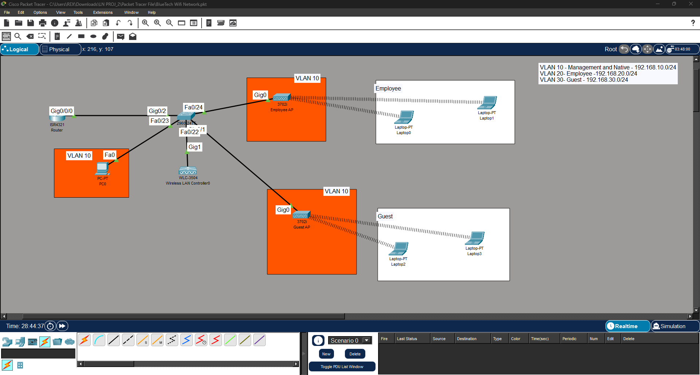

# BlueTech Enterprise WLAN

Enterprise wireless network designed and tested in Cisco Packet Tracer
using a Wireless LAN Controller and lightweight access points.

## Topology

## Design
- WLC-3504 managing 2 lightweight APs (3702i)
- Two WPA2 SSIDs: WLAN-20 (Employee, VLAN 20) and WLAN-30 (Guest, VLAN 30)
- FlexConnect local switching
- Router-on-a-stick (ISR4321) for inter-VLAN routing
- Switch trunk ports to router, WLC, and APs; VLAN 10 as native
- DHCP: WLC internal scope for APs, router pools for wireless clients

## What I Configured
1. VLANs and trunking on the 2960 switch
2. Router subinterfaces and DHCP pools
3. WLC initial setup (admin account, static management IP 192.168.10.254)
4. Dynamic interfaces mapped to VLAN 20 and VLAN 30
5. WLAN profiles (WLAN-20 and WLAN-30) with WPA2 security
6. Second AP added to scale the network

## IP, VLAN and SSID Table
See [ip-vlan-table.md](ip-vlan-table.md)

## Test Results
| Test | Result |
|------|--------|
| Both APs register with the WLC | Pass |
| Employee laptops get 192.168.20.x | Pass |
| Guest laptops get 192.168.30.x | Pass |
| Inter-VLAN ping | Pass |

Screenshots are in the `screenshots` folder.
Configs are in the `configs` folder.

## What I Learned
Through this project, I gained practical knowledge of how to implement and manage a Wireless LAN (WLAN) and understand how it works in a real-world business environment.
I had the opportunity to explore and work with new networking devices, including Wireless LAN Controllers (WLCs) and Access Points (APs). I also gained hands-on experience with important networking concepts and technologies such as CAPWAP tunnels, FlexConnect, and WPA2 security.
Overall, this project helped me strengthen my practical networking skills and successfully build a fully functional Wireless LAN for a company environment.

## Tools
Cisco Packet Tracer
